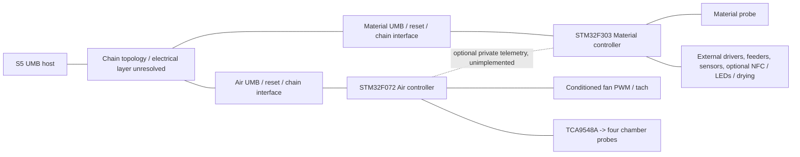

# Conceptual connections: two STM32 controllers

This is a symbolic node list, not a board schematic or wiring approval. P means
proposed, R reserved, H unresolved/hold. No concrete GPIO, physical UMB contact
number, transceiver or chain order is assigned. The [CSV](connection_nodes.csv)
uses `PIN_*_TBD` functional reservations, not connected pins.

| Component | Suggested bench board | Responsibility |
|---|---|---|
| U_AIR | NUCLEO-F072RB | Air Manager, fan PWM/tach and four chamber probes |
| U_MATERIAL | NUCLEO-F303ZE | Material Station, material probe and station hardware |
| U_AIR_UMB / U_MATERIAL_UMB | Not selected | Independent UART, boot/reset and chain-control interfaces |
| U_AIR_POWER / U_MATERIAL_POWER | Board-specific selection | Regulated board input and USB backfeed protection |

STM32 is required for this project because the observed stock S5 host identifies
accessories through an STM32 bootloader interface and distinct chip-ID/memory
profiles. Each MCU serves one fixed role. Matching silicon alone does not solve
boot entry, stock firmware updates, chain gating or operational behavior. See
[STM32 deployment](STM32_DEPLOYMENT.md) and
[startup/health requirements](../ACCESSORY_DISCOVERY_AND_HEALTH.md).

The chain block does not assert star/parallel electrical wiring. Determine actual
upstream/downstream gating and order from stock hardware/captures. Both fixture
sketches use manual address zero only in isolation; never attach them as working
addressed accessories to a real chain.

## Power and logic

A proposed separate protected 24 V supply feeds fan and logic-converter branches.
No UMB power contact is identified. Motor/coil supply voltage is separately TBD.
A regulated 5 V rail may feed reviewed board input circuits and an appropriate
fan PWM interface; it is not STM32 VDD or GPIO. Each board supplies a reviewed
3.3 V logic/sensor domain. Check regulator budget and USB/ST-LINK power selection.

MCU-side UART, I2C pullups, GPIO, tach conditioning and optional ADC use 3.3 V
levels. Do not assume all STM32 inputs tolerate 5 V. Fan/driver current returns
must not flow through MCU/sensor wires. External UMB reference, isolation,
chassis, shield and protective earth remain unresolved. Domain bonds need review.

## Air reservations

Reserve one valid USART pair, one active-low role-enable input, one I2C pair,
a timer output for approximately 25 kHz PWM, and a tach capture/interrupt input.
Preserve independent SWDIO/SWCLK/NRST recovery. Boot/reset/next-link signals are
functional reservations pending the actual external chain circuit. Concrete pins
must be checked against ROM boot UARTs, alternate functions, SWD and board wiring.

TCA9548A 0x70 channels 0..3 connect four PTFE SHT45 0x44 chamber probes. Channels
4..7 are unused/reserved. Verify breakout power and pullups. Chamber probes do
not automatically have the stock ambient/exhaust sensor meanings.

Fan PWM output requires a conditioned CMOS-compatible driver appropriate for the
actual fan, including powered-off behavior and reset/failure policy. Open-collector
tach is a different circuit, pulled up to 3.3 V with reviewed resistance and fan
sink-current limits. No timer number, physical pin, ISR or final resistor value
is assigned. No fan driver is implemented in the sketch.

## Material reservations

The Material STM32 has its own UMB interface, fixed-role enable jumper, debug
access and I2C bus. One SHT45 0x44 is connected directly to this local bus for the
material compartment. Optional GPIO/LED devices require unique addresses and
reviewed 3.3 V pullups.

The CSV reserves six external STEP/DIR/enable feeder-driver positions as a custom
mechanism option, not a finding about stock motor count. Rewinder, selectors,
solenoids, decouplers, filament sensors, door/endstops/fault inputs, NFC and drying
hardware remain backend work. Slow GPIO expansion does not supply deterministic
STEP timing. External power stages, driver conditioning and disabled reset states
are required. Never drive motors, coils or heaters directly from a GPIO.

A private inter-controller telemetry link is optional and unimplemented. Its
protocol, pin map, isolation/reference and stale-data policy require a separate
design; it must not become a second UMB master.

## Regenerate and review

Run `python tools/build_connection_nodes.py` to regenerate the CSV. The generator
checks duplicate node entries only; it is not electrical-rule, alternate-function,
resource, timing or physical validation. Review exact Nucleo schematics, actual
fan and sensor modules, UMB circuits and mechanism loads before assigning GPIO.

References: [STM32 plan and board sources](STM32_DEPLOYMENT.md),
[Noctua PWM specification](https://cdn.noctua.at/media/Noctua_PWM_specifications_white_paper.pdf),
[SHT4x breakout wiring](https://learn.adafruit.com/adafruit-sht40-temperature-humidity-sensor/pinouts),
[TCA9548A breakout](https://learn.adafruit.com/adafruit-tca9548a-1-to-8-i2c-multiplexer-breakout/pinouts).
