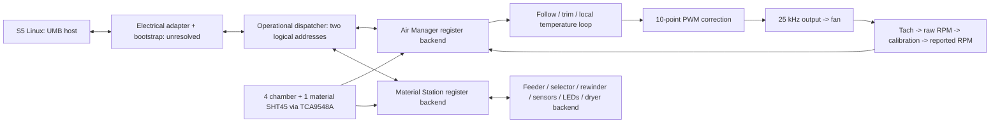

# Replacement accessory design

## System boundary

The goal is one Arduino-type controller that presents Air Manager and/or Material Station behavior to an S5, receives UMB demands, controls local hardware, and returns measurements/state. Both mode means **two logical devices**, not two uncontrolled masters.

## Jumper roles

Use pull-ups and sample jumpers at boot. Low means enabled. A missing/open jumper reads high.

| AIR pin | MATERIAL pin | Role |
|---|---|---|
| High | High | Disabled/bench only |
| Low | High | Air Manager |
| High | Low | Material Station |
| Low | Low | Both |

The bench sketch manually attaches Material at address 0 and Air at 1 in both mode, or the sole device at 0. These are **bench choices, not established stock address assignments**. Real addresses must be negotiated. Changing jumper identity during operation is not supported.

## Largest integration dependency: startup

The operational protocol is understood, but the stock Linux UMB daemon does more before reading registers: resets/enumerates STM32 devices, reads chip identification/options, verifies or updates firmware, starts application code, assigns an address and enables the next physical link. An Arduino AVR does not implement this STM32 bootstrap by default. The daemon infers accessory identity from known MCU configuration; merely answering register reads at address 0 is insufficient.

One MCU serving two logical roles may also need to emulate physical chain enumeration/gating. The protocol router demonstrates operational address dispatch, not successful stock enumeration. We must capture real startup and determine whether a compatible front-end, separate logical endpoints, or an explicitly modified Linux bootstrap adapter is required. No firmware flashing/erasing/reset implementation is included. This dependency could change the final MCU/interface choice.

## Fan control and telemetry

Confirmed standard Noctua interface, conditional on the installed model/wiring: constant 24 V motor supply, separate logic-level PWM input targeting 25 kHz, tachometer open-collector feedback with two pulses/revolution. Four-wire fan tach is **not a returned PWM command**. `RPM = pulse_frequency_hz * 30`. The board driver must atomically snapshot the ISR edge counter and handle stalled/stale measurements.

The draft `FanModel` converts an edge-count delta over elapsed milliseconds to raw RPM, applies the optional RPM calibration, and tracks freshness. A zero-edge interval reports zero speed, not a fabricated healthy RPM. Do not remap RPM to satisfy S5 expectations while hiding a stopped, obstructed or mismatched fan. Both raw and reported RPM should be logged.

Physical fan PWM output and tach ISR are not implemented. Default Arduino `analogWrite()` frequency is not the Noctua target. A proposed Mega output is OC3A/D5 using Timer3, with a separate tach interrupt input such as D2. Verify pin/timer ownership before implementation. Keep 24 V off MCU and signal pins. Noctua's paper recommends a CMOS driving circuit rather than an assumed open-collector PWM output; tach feedback itself is open collector. A 24 V fan's tach pull-up current must respect its 2 mA limit. Final circuit values await the actual fan/interface review.

### Units and three separate conversions

1. **S5 requested airflow (m3/h) -> nominal duty (%): unresolved plant calibration.** The inspected S5 writes `data.fanAirflowSetPoint.0`, not a percentage. No implicit mapping of 48 m3/h to 48% is permitted.
2. **Nominal duty (%) -> driven duty (%): implemented ten-point correction.** Default identity knots: 0,10,20,30,40,50,60,70,85,100 on both axes.
3. **Measured raw RPM -> reported RPM: implemented ten-point measurement correction.** Default identity knots 0,1000,...,9000 RPM; this is an illustrative broad domain, not a fan speed rating. Replace the domain using measured useful range. Out-of-range clamping is explicitly flagged and must generate diagnostic treatment.

Tables use linear interpolation between adjacent knots. Input coordinates must strictly increase; output coordinates must not decrease; non-finite values are rejected. PWM mapping is constrained to 0..100%. RPM mapping must map stopped rotor 0 -> 0. An OFF command bypasses PWM calibration and requests zero duty. Check exact fan behavior at zero PWM; full electrical power disconnection, if required, needs a separate switching stage.

The RPM table is not the numerical inverse of the PWM table: the axes and physical meanings differ. It can calibrate the sensor/reporting convention, but actual tachometer pulses remain the source of speed feedback.

Stock `data.fanDutyCycle.0` raw scale and `fanSpeedRatio` health algorithm are not established. Keep them unbound until validated. A reported PWM duty is the actual applied command after correction; it is not the upstream nominal demand. Measured airflow cannot be fabricated from PWM/RPM alone without calibration or a suitable sensor.

### Optional temperature loop

`ThermalControl` has three modes:

| Mode | Demand behavior |
|---|---|
| FollowFeedForward (default) | Follow calibrated nominal duty derived from S5 airflow; no local temperature correction |
| TrimFeedForward | Add bounded PI correction to that nominal duty |
| LocalFeedback | Derive duty from local chamber temperature and local target; ignore S5 airflow magnitude |

All modes retain host fan power as a separate enable in the draft. An independent overtemperature ventilation override may be added after practical testing, but is not silently assumed. No mode bypasses S5 error handling or falsifies feedback.

The loop selects any nonempty subset of chamber probes 0..3 and aggregates by maximum or mean. Probe 4 is the material compartment and is rejected as a chamber-loop input. If any selected sensor is invalid/stale, the loop returns an invalid result; it does not silently substitute another location. The future hardware adapter must execute an explicit fault policy, such as calibrated feed-forward fallback or a validated ventilation setting, and report the fault. There is no implemented fault-actuation policy yet.

The local target defaults to an illustrative 35 C and must be configured locally. We have not found a UMB endpoint delivering S5 desired chamber temperature. Do not derive target temperature from fan demand. The loop is PI, with conditional anti-windup, bounded output and explicit elapsed-time checks; gains are examples and are **not tuned**. Reset the integrator on control-mode, target or sensor-mask changes. This is a cooling-only plant: increasing exhaust cannot achieve an arbitrarily warm chamber, and cannot cool below available inlet-air conditions.

Planned diagnostics, not yet wired as extra registers: control mode, raw airflow request, feed-forward nominal percentage, selected temperature, target, applied PWM, raw/reported RPM, ignored-demand flag, clamping and fault reason.

## Environmental sensing

Use five SHT45 PTFE-covered breakout boards, one each on TCA9548A channels 0..4 at sensor address 0x44. Channels 0..3 belong to the print chamber and channel 4 to material storage. The proposed `custom.*` register bank exposes ten readings plus per-sensor validity and age. Custom registers appear in both draft profiles for convenient discovery; this does not populate stock UI fields automatically.

The provided sampler sequences one sensor at a time, requests SHT4x high-precision measurement 0xFD, waits without delay(), validates both sensor CRCs (0x31 polynomial, initial FF), converts temperature/RH and timestamps results. Default sampling period is approximately two seconds after a sweep; proposed stale threshold is ten seconds. Sensor CRC is distinct from UMB CRC (0x07). MCU/I2C timeout settings and routing noise still need testing.

Use sensor breakouts with appropriate logic-level translation for the selected MCU. The bare SHT45 maximum supply is 3.6 V. PTFE protects against particles, not all polymer vapors. Mount probes away from radiant bed heating and frame conduction; compare all probes together before installation. Consider a chamber probe near the exhaust for stock exhaust-temperature semantics. The requested five probes do not include a true external ambient probe, so the stock `ambientTemp` field needs a deliberate source or an additional sensor; material-compartment temperature is not automatically ambient.

## Material handling abstraction

`prefeeder_n.printer_command.0` values invoke asynchronous operations, not raw GPIO actions. The controller must translate them into hardware-specific movement/selection and report states/transitions only from verified feedback. At minimum, a load operation needs route selection, old-filament clearance, controlled advance, arrival detection, handoff to the existing S5 feeder, and detection of jams/timeouts. Unload needs proper tip preparation coordinated by S5, retraction and spool management. A passive splitter cannot supply these functions.

Use a pluggable backend for (a) stock mechanics, (b) redesigned feeder/selector/clutch mechanisms, and (c) a bench simulator. The hardware API must keep motion scheduling separate from UMB parsing and I2C sampling. No blocking run-until-switch loop in the serial loop. Position sensors, debounced inputs, timeouts, driver faults and door/error state must constrain movement. Exact states/transition numbers and endpoints are preserved in the evidence; custom mechanics need equivalent observable behavior, not identical internal mechanisms.

Both printer extrusion paths must remain independent. Do not route six sources into a single shared downstream tube and expect both nozzles to work simultaneously. Initial mechanical testing may use fixed subsets of bays per extrusion path; that is a reduced-function prototype, since the original station can supply either extruder from each bay.

NFC support is separate from material transport. Third-party materials can be manually identified in the normal printer workflow, but omitted NFC hardware still needs protocol-compatible behavior; successful no-NFC accessory emulation has not been demonstrated. Likewise a humidity probe does not implement the original dehumidifier's fan/heater/valve/regeneration state machine.

## Provisional I/O and board budget

| Function | Direct MCU I/O estimate | Confidence |
|---|---:|---|
| One UMB UART | 2 + possible transceiver enable/reset | Framing confirmed; electrical control lines unknown |
| Role jumpers | 2 | Proposed |
| TCA9548A + five SHT45 | 2 shared I2C + optional reset | Proposed, does not consume two pins per sensor |
| Fan command / tach | 2 | Standard fan interface; installed wiring pending |
| STEP/DIR for one stepper per bay | 12 + enable(s) | Illustrative architecture, NOT verified stock motor count |
| Two filament detection inputs per bay | up to 12 | Events exist; physical implementation/count pending |
| Selector/clutch/solenoid controls | TBD | Mechanism dependent |
| Rewinder | driver-dependent, e.g. PWM + direction + enable | Logical motor endpoints confirmed; actual circuit unknown |
| Left/right decoupler feedback | TBD | Logical feedback/calibration confirmed |
| Lights | I2C/SPI LED driver, or many GPIO | 12 bay light channels + frame index 15 observed |
| Door / driver fault / selector endstops | TBD | Door/endstop functions observed; counts pending |
| NFC + antenna selection | bus + chip selects/control, TBD | Six-bay selection software confirmed |
| Dryer fan/heater/valve/endstops | TBD | State names confirm functions, not circuits |

This quickly exceeds a Mini-class direct-I/O budget. A Mega can start the prototype; I2C GPIO/LED expansion can handle slow indicators/inputs, while time-sensitive step/tach/PWM signals stay on deterministic MCU peripherals. Motor drivers and solenoid switches are needed regardless of MCU size. Use regulated 24 V-to-logic supply circuitry; do not power the MCU directly from a 24 V fan rail. The final design may benefit from a modern 32-bit MCU or separate motion I/O modules.

## Milestones / acceptance

1. Offline protocol and domain tests (provided); verify exact Arduino target compile and resource use next.
2. Board photographs and schematic/continuity work: identify UMB electrical layer, pinout, power, chain gating and sensor/actuator wiring.
3. Passive startup/operational capture with a genuine accessory; resolve delimiter, register units, discovery, delays and watchdogs.
4. Bench sensor/fan controller: real 25 kHz waveform, tach pulse checks, table interpolation, sensor removal, stalled rotor, startup behavior.
5. Identify electrical/bootstrap interface capable of a single role first; prove device recognition without fake stock state.
6. Build one feeder path on a bench using 2.85 mm filament. Validate feed, retract, park, tension, selector feedback and recovery. Expand to both extrusion paths and then six bays.
7. Tune airflow conversion with actual housing/filter; validate identity mode before enabling local temperature trim. Test closed-loop mode last, including target unreachable, sensor stale and communication loss.
8. Validate both logical roles together and truthful S5 telemetry, then endurance tests and documentation updates.

## References

- Arduino Mega hardware: https://docs.arduino.cc/hardware/mega-2560/
- Noctua PWM/tach specification: https://cdn.noctua.at/media/Noctua_PWM_specifications_white_paper.pdf
- SHT45: https://sensirion.com/products/catalog/SHT45
- PTFE SHT45: https://sensirion.com/products/catalog/SHT45-AD1F/
- Adafruit breakout wiring: https://learn.adafruit.com/adafruit-sht40-temperature-humidity-sensor/pinouts
- TCA9548A: https://www.ti.com/lit/ds/symlink/tca9548a.pdf
- Air Manager operation: https://um-support-files.ultimaker.com/manuals/user-manual/S5-Air-Manager/Ultimaker%20S5%20Air%20Manager%20-%20User%20manual%20ENv2.2.pdf
- Air Manager PCB repair/photos: https://um-support-files.ultimaker.com/manuals/repair-calibration/S-series/Repair-manual-Air-Manager-PCB.pdf
- Material Station specifications: https://um-support-files.ultimaker.com/manuals/user-manual/S5-Material-Station/Ultimaker%20S5%20Material%20Station%20-%20User%20manual%20ENv2.0.pdf
- S5 material size/path limitations: https://support.ultimaker.com/articles/Knowledge/1667410781011
